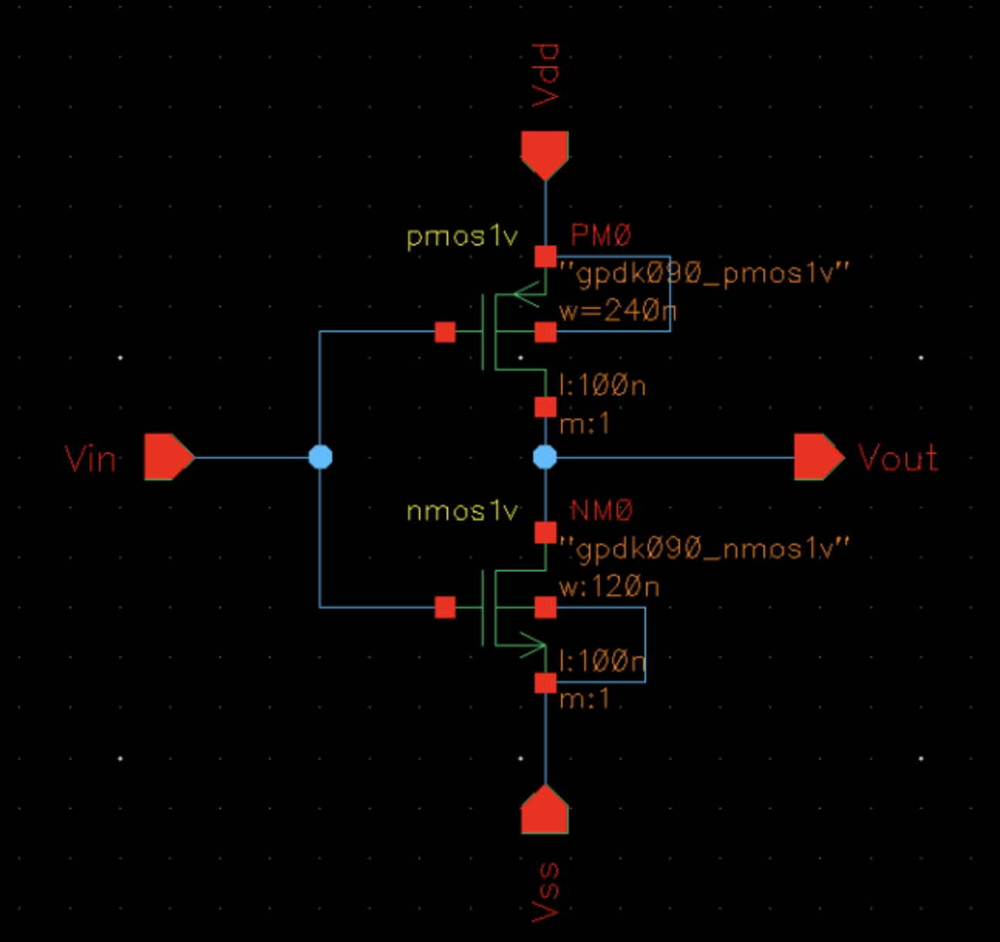
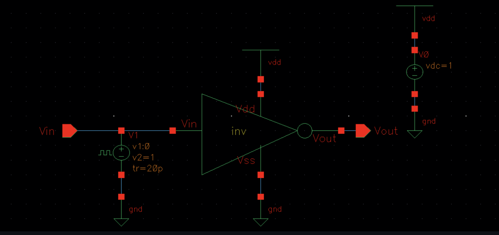
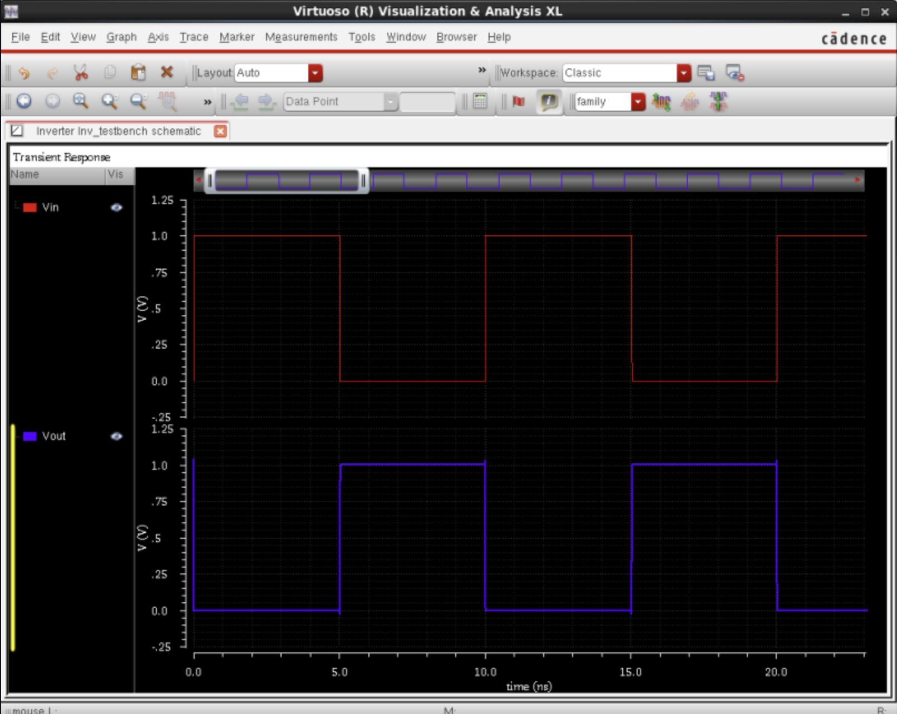
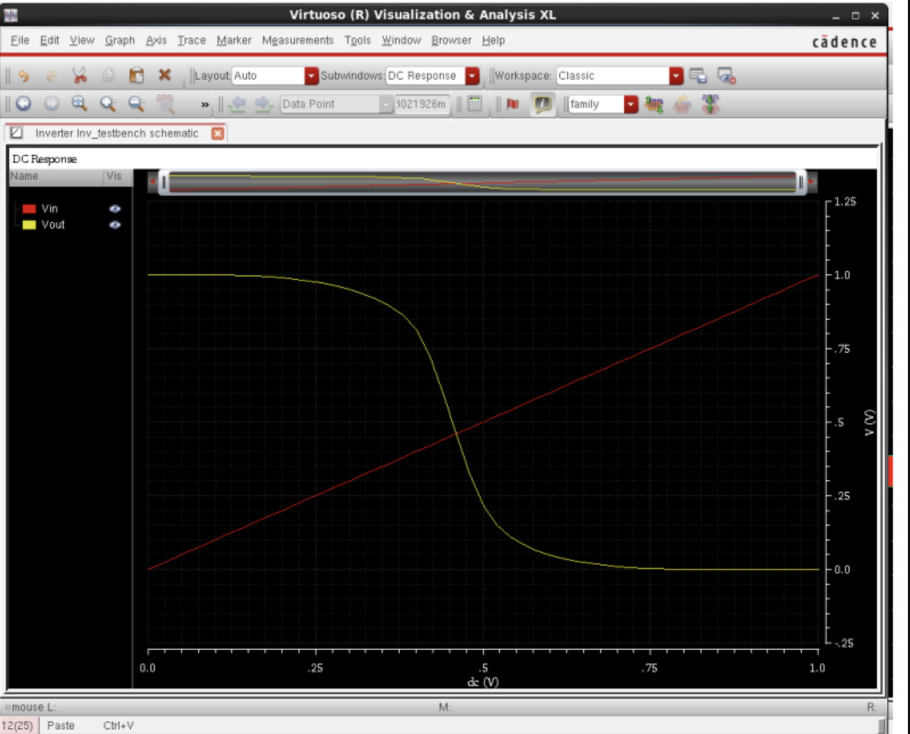
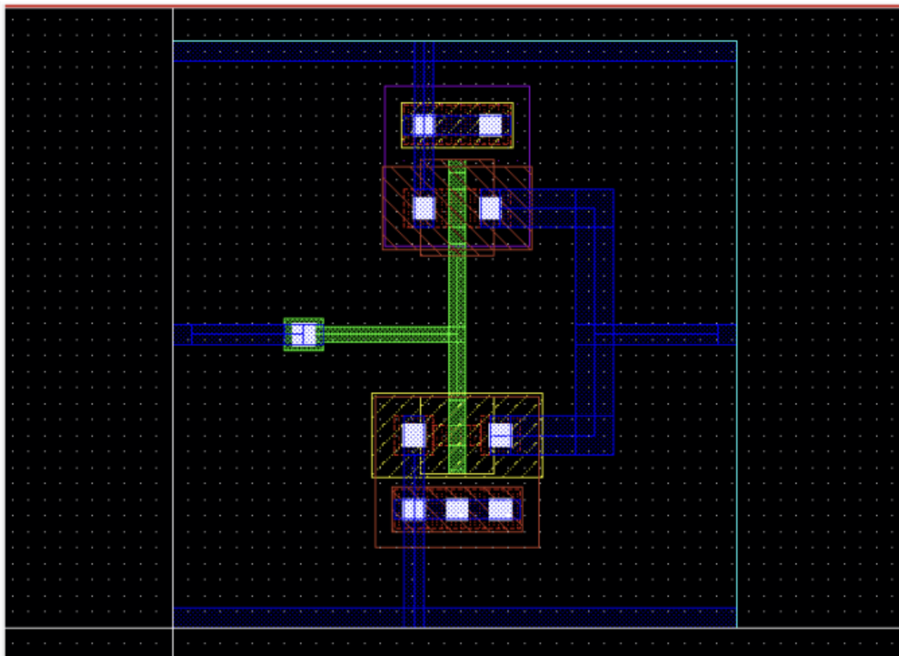
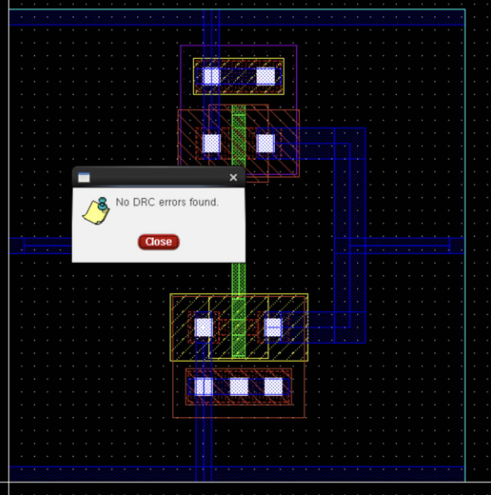
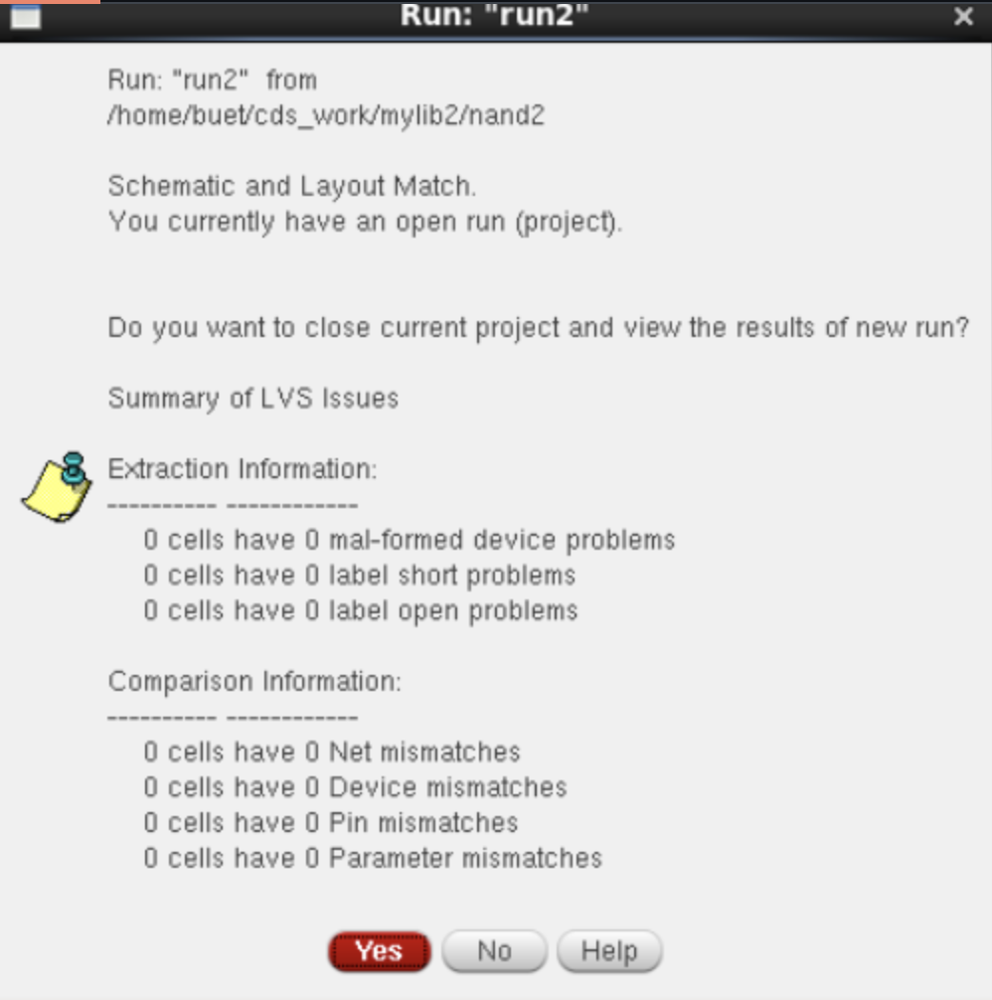
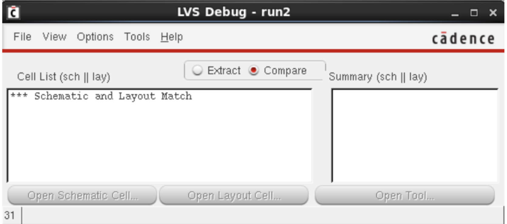
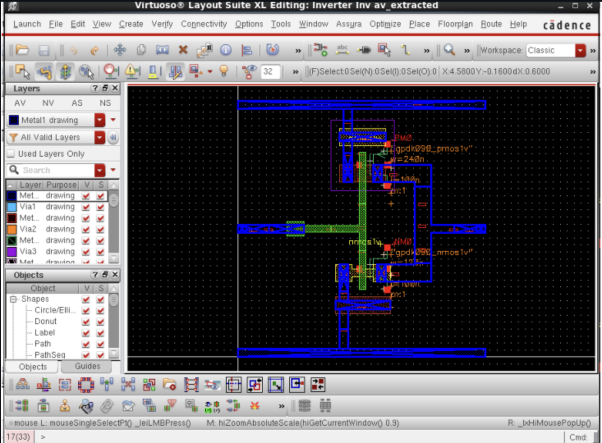

# Full-Custom CMOS Inverter Design, Simulation & Physical Verification in Cadence Virtuoso (GPDK 90nm)

[](#specifications--design-summary)
[](#cadence-virtuoso-eda-flow)
[](#physical-verification)
[-blueviolet.svg)](#author)
[](LICENSE)

---

## Table of Contents
1. [Project Overview](#project-overview)
2. [Specifications & Design Summary](#specifications--design-summary)
3. [Schematic Design & Sizing Rationale](#schematic-design--sizing-rationale)
4. [Testbench & Simulation Setup](#testbench--simulation-setup)
5. [Pre-Layout Simulation Results](#pre-layout-simulation-results)
   - [Transient Analysis](#1-transient-analysis)
   - [DC Voltage Transfer Characteristics (VTC) & Noise Margins](#2-dc-voltage-transfer-characteristics-vtc--noise-margins)
6. [Physical Layout Design (Layout XL)](#physical-layout-design-layout-xl)
7. [Physical Verification](#physical-verification)
   - [Design Rule Check (DRC)](#1-assura-design-rule-check-drc)
   - [Layout Versus Schematic (LVS)](#2-assura-layout-versus-schematic-lvs)
8. [Parasitic Extraction (Assura RCX / av_extracted)](#parasitic-extraction-assura-rcx--av_extracted)
9. [Cadence Virtuoso EDA Flow](#cadence-virtuoso-eda-flow)
10. [Repository File Hierarchy](#repository-file-hierarchy)
11. [Author & Acknowledgments](#author--acknowledgments)

---

## Project Overview

This repository presents the end-to-end full-custom Integrated Circuit (IC) design, SPICE simulation, mask-level layout, and physical verification of a static **CMOS Inverter** implemented using the **Cadence Virtuoso** custom IC design suite on the **Cadence 90nm Generic Process Design Kit (GPDK090)**.

The primary design objectives include:
- Establishing symmetric high-to-low ($t_{pHL}$) and low-to-high ($t_{pLH}$) propagation delays by analytically sizing the PMOS-to-NMOS aspect ratio ($\beta$-ratio).
- Maximizing static noise margins ($NM_L, NM_H$) by centering the inverter switching threshold ($V_M$) at approximately $V_{DD} / 2 = 0.50\text{ V}$.
- Generating a DRC-clean and LVS-matched physical mask layout complying with sub-micron 90nm manufacturing design rules.
- Suppressing latch-up susceptibility via substrate ($P\text{-tap}$) and N-well ($N\text{-tap}$) tie contacts.
- Back-annotating layout-extracted parasitic capacitances and resistances (`av_extracted`) for post-layout characterization.

---

## Specifications & Design Summary

| Parameter | Symbol | Target / Designed Value | Unit |
| :--- | :--- | :--- | :--- |
| **Process Technology** | - | Cadence GPDK090 (90nm Bulk CMOS) | - |
| **Supply Voltage** | $V_{DD}$ | $1.0$ | $\text{V}$ |
| **Ground Reference** | $V_{SS}$ | $0.0$ | $\text{V}$ |
| **PMOS Device Model** | - | `gpdk090_pmos1v` | - |
| **PMOS Channel Width** | $W_p$ | $240$ | $\text{nm}$ |
| **PMOS Channel Length** | $L_p$ | $100$ | $\text{nm}$ |
| **PMOS Multiplier** | $m_p$ | $1$ | - |
| **NMOS Device Model** | - | `gpdk090_nmos1v` | - |
| **NMOS Channel Width** | $W_n$ | $120$ | $\text{nm}$ |
| **NMOS Channel Length** | $L_n$ | $100$ | $\text{nm}$ |
| **NMOS Multiplier** | $m_n$ | $1$ | - |
| **Sizing Aspect Ratio** | $W_p / W_n$ | **$2.0$** ($\mu_n \approx 2\mu_p$ mobility matching) | - |
| **Switching Threshold** | $V_M$ | $\approx 0.48$ | $\text{V}$ |
| **Physical Verification** | DRC / LVS | **100% Clean / 0 Mismatches** | - |

---

## Schematic Design & Sizing Rationale

The CMOS inverter consists of a complementary pull-up network (PUN) using a single PMOS transistor and a pull-down network (PDN) using a single NMOS transistor.

### Sizing Rationale ($\beta$-Ratio)
In bulk silicon CMOS technology, electron bulk surface mobility ($\mu_n \approx 450\text{ cm}^2/\text{V}\cdot\text{s}$) is approximately 2 to 2.5 times higher than hole mobility ($\mu_p \approx 180\text{ cm}^2/\text{V}\cdot\text{s}$) due to band structure effective mass differences:
$$\mu_n \approx 2 \times \mu_p$$

The transconductance parameter is defined as:
$$\beta_n = \mu_n C_{ox} \left(\frac{W_n}{L_n}\right), \quad \beta_p = \mu_p C_{ox} \left(\frac{W_p}{L_p}\right)$$

To achieve an identical current driving capability for charging and discharging the load capacitance ($I_{D,sat(n)} \approx I_{D,sat(p)}$), the channel width of the PMOS is sized to twice the width of the NMOS for equal channel lengths ($L_n = L_p = 100\text{ nm}$):
$$\frac{W_p}{W_n} = \frac{240\text{ nm}}{120\text{ nm}} = 2.0$$

This balances the pull-up and pull-down transition times and aligns the switching threshold $V_M$ close to $V_{DD}/2 = 0.50\text{ V}$.

<div align="center">
  
  <p><b>Figure 1:</b> CMOS Inverter Schematic in Cadence Virtuoso Schematic XL showing PMOS (240nm / 100nm) and NMOS (120nm / 100nm).</p>
</div>

---

## Testbench & Simulation Setup

A dedicated testbench cell (`Inv_testbench`) was configured to simulate the static and dynamic characteristics of the inverter:
- **DC Supply Source ($V_0$):** Set to $V_{DC} = 1.0\text{ V}$ connecting the `vdd` net to global ground (`gnd`).
- **Input Signal Source ($V_1$):** Pulse voltage source connected to `vin`:
  - Initial voltage ($V_1$): $0.0\text{ V}$
  - Pulsed voltage ($V_2$): $1.0\text{ V}$
  - Rise time ($t_r$): $20\text{ ps}$
  - Fall time ($t_f$): $20\text{ ps}$
  - Pulse width: $5.0\text{ ns}$
  - Period: $10.0\text{ ns}$ (100 MHz clock equivalent)
- **Substrate Connections:** PMOS bulk connected to $V_{DD}$, NMOS bulk connected to $V_{SS}$ (eliminating body effect, $V_{SB} = 0$).

<div align="center">
  
  <p><b>Figure 2:</b> Inverter Testbench Schematic (<code>Inv_testbench</code>) with pulse generator stimulus and DC power supply.</p>
</div>

---

## Pre-Layout Simulation Results

Simulations were performed using **Cadence Virtuoso ADE L** with waveforms displayed via **Virtuoso Visualization & Analysis XL**.

### 1. Transient Analysis
Transient analysis was performed over a $20\text{ ns}$ execution window:
- When $V_{in}$ transitions from $0\text{ V} \rightarrow 1\text{ V}$ (logic '0' to '1'), the NMOS turns ON and the PMOS turns OFF, pulling $V_{out}$ rail-to-rail from $1\text{ V} \rightarrow 0\text{ V}$ (logic '1' to '0').
- When $V_{in}$ transitions from $1\text{ V} \rightarrow 0\text{ V}$, the PMOS turns ON and the NMOS turns OFF, pulling $V_{out}$ rail-to-rail from $0\text{ V} \rightarrow 1\text{ V}$.
- Clean full-swing digital inversion is observed with sharp sub-nanosecond rise and fall edges.

<div align="center">
  
  <p><b>Figure 3:</b> Transient simulation response showing input pulse (red) and inverted output (blue) over 20ns.</p>
</div>

### 2. DC Voltage Transfer Characteristics (VTC) & Noise Margins
A DC sweep of $V_{in}$ from $0.0\text{ V}$ to $1.0\text{ V}$ with a $5\text{ mV}$ step was executed to obtain the Voltage Transfer Characteristic (VTC) curve:

<div align="center">
  
  <p><b>Figure 4:</b> DC Voltage Transfer Characteristic (VTC) curve displaying sharp transition and switching threshold $V_M \approx 0.48\text{ V}$.</p>
</div>

#### Operational Regions Analysis:
1. **Region A ($0 \le V_{in} < V_{tn}$):**
   - NMOS: Cutoff ($V_{GSn} < V_{tn}$)
   - PMOS: Linear / Triode ($V_{SGp} > |V_{tp}|, V_{SDp} \approx 0$)
   - $V_{out} = V_{OH} = V_{DD} = 1.0\text{ V}$.
2. **Region B ($V_{tn} \le V_{in} < V_M$):**
   - NMOS: Saturation ($V_{DSn} > V_{GSn} - V_{tn}$)
   - PMOS: Linear ($V_{SDp} < V_{SGp} - |V_{tp}|$)
   - $V_{out}$ gradually decreases with increasing $V_{in}$.
3. **Region C ($V_{in} = V_M \approx 0.48\text{ V}$):**
   - Both NMOS and PMOS are in **Saturation**.
   - Maximum small-signal voltage gain: $A_v = \frac{dV_{out}}{dV_{in}} = -(g_{mn} + g_{mp})(r_{on} \parallel r_{op})$.
4. **Region D ($V_M < V_{in} \le V_{DD} - |V_{tp}|$):**
   - NMOS: Linear ($V_{DSn} < V_{GSn} - V_{tn}$)
   - PMOS: Saturation ($V_{SDp} > V_{SGp} - |V_{tp}|$)
5. **Region E ($V_{in} > V_{DD} - |V_{tp}|$):**
   - NMOS: Linear
   - PMOS: Cutoff ($V_{SGp} < |V_{tp}|$)
   - $V_{out} = V_{OL} = 0.0\text{ V}$.

#### Noise Margin Calculations:
- $V_{OH} = 1.0\text{ V}$ (Output High Voltage)
- $V_{OL} = 0.0\text{ V}$ (Output Low Voltage)
- $V_{IL} \approx 0.42\text{ V}$ (Point where slope $\frac{dV_{out}}{dV_{in}} = -1$ in Region B)
- $V_{IH} \approx 0.54\text{ V}$ (Point where slope $\frac{dV_{out}}{dV_{in}} = -1$ in Region D)
- **Noise Margin Low ($NM_L$):** $NM_L = V_{IL} - V_{OL} \approx 0.42\text{ V} - 0.0\text{ V} = \mathbf{0.42\text{ V}}$
- **Noise Margin High ($NM_H$):** $NM_H = V_{OH} - V_{IH} \approx 1.0\text{ V} - 0.54\text{ V} = \mathbf{0.46\text{ V}}$

---

## Physical Layout Design (Layout XL)

The physical mask layout was synthesized and completed in **Cadence Virtuoso Layout Suite XL**:
- **N-Well:** Encloses the PMOS active region to isolate the p-channel transistor from the p-type substrate.
- **Transistor Active Layers:** Defined using `Oxide` / `Diff` diffusion regions with proper source/drain geometries.
- **Gate Material (Poly):** A single vertical continuous poly-silicon strip simultaneously forms the gates for both the PMOS and NMOS devices, minimizing interconnect delay and input parasitic capacitance.
- **Metal 1 Power Rails:**
  - Top horizontal Metal 1 strip: $V_{DD}$ rail.
  - Bottom horizontal Metal 1 strip: $V_{SS}$ rail.
- **Output Routing:** Shared Metal 1 connection bridging the PMOS drain and NMOS drain to form the output node ($V_{out}$).
- **Latch-Up Prevention:**
  - $N\text{+ Tap}$ (Well tap) inserted into the N-well connected to $V_{DD}$ to prevent forward biasing of the parasitic $p\text{-}n\text{-}p\text{-}n$ SCR structure.
  - $P\text{+ Tap}$ (Substrate tap) inserted into the p-substrate connected to $V_{SS}$ to clamp substrate noise and prevent ground bounce latch-up triggers.

<div align="center">
  
  <p><b>Figure 5:</b> Custom CMOS Inverter layout in Cadence Virtuoso Layout XL with N-well, Poly gates, Metal 1 rails, and tap contacts.</p>
</div>

---

## Physical Verification

Physical verification was performed using **Cadence Assura** to guarantee foundry-level fabrication compliance.

### 1. Assura Design Rule Check (DRC)
Assura DRC checked the entire layout against GPDK090 physical design rules, including:
- Minimum width and spacing rules for Poly, Diffusion, N-Well, and Metal 1.
- Contact and via enclosure dimensions.
- Antenna ratio constraints.

**Result:** **0 DRC violations found.**

<div align="center">
  
  <p><b>Figure 6:</b> Cadence Assura DRC Run completed successfully with <b>"No DRC errors found"</b>.</p>
</div>

### 2. Assura Layout Versus Schematic (LVS)
Assura LVS verified 1-to-1 equivalence between the extracted layout netlist and the schematic netlist:
- Net integrity check (shorts and opens).
- Device type and count verification.
- Transistor geometric parameter comparison ($W, L$).
- Pin and port correspondence.

**Summary of LVS Verification:**
- Device problems: **0**
- Label shorts / opens: **0**
- Net mismatches: **0**
- Device mismatches: **0**
- Pin mismatches: **0**
- Parameter mismatches: **0**

<div align="center">
  
  <p><b>Figure 7:</b> Assura LVS Run confirmation showing complete match across all nets, devices, pins, and parameters.</p>
</div>

<div align="center">
  
  <p><b>Figure 8:</b> Assura LVS Debug window confirming <code>*** Schematic and Layout Match</code>.</p>
</div>

---

## Parasitic Extraction (Assura RCX / av_extracted)

Following successful LVS verification, **Assura RCX (Parasitic Extraction)** was executed to extract parasitic resistances and capacitances (interconnect capacitances, overlap capacitances, and fringe fields).

The generated `av_extracted` view includes all extracted physical parasitics back-annotated onto the cell view for accurate post-layout timing and dynamic power simulation.

<div align="center">
  
  <p><b>Figure 9:</b> Parasitic Extracted layout view (<code>Inverter Inv av_extracted</code>) displaying back-annotated device and interconnect parasitics.</p>
</div>

---

## Cadence Virtuoso EDA Flow

The design flow executed in this project follows standard semiconductor foundry methodology:

```text
+-------------------------------------------------------------------------+
|                       CADENCE VIRTUOSO ANALOG / FULL-CUSTOM FLOW        |
+-------------------------------------------------------------------------+
                                     |
                                     v
                 +---------------------------------------+
                 | 1. Schematic Design (Schematic XL)   |
                 |    - PMOS (240n/100n), NMOS (120n/100n)|
                 |    - Pin and rail definitions         |
                 +---------------------------------------+
                                     |
                                     v
                 +---------------------------------------+
                 | 2. Symbol Creation                    |
                 |    - Inverter symbol cellview 'inv'   |
                 +---------------------------------------+
                                     |
                                     v
                 +---------------------------------------+
                 | 3. Testbench Setup & SPICE Simulation |
                 |    - ADE L (Spectre Simulator)        |
                 |    - Transient Analysis (0 - 20ns)    |
                 |    - DC VTC Sweep (0.0V - 1.0V)       |
                 +---------------------------------------+
                                     |
                                     v
                 +---------------------------------------+
                 | 4. Mask Layout Design (Layout XL)     |
                 |    - Transistor placement & diffusion |
                 |    - Continuous poly gate routing     |
                 |    - Metal 1 power rails & pins       |
                 |    - Guard rings & substrate taps     |
                 +---------------------------------------+
                                     |
                                     v
                 +---------------------------------------+
                 | 5. Assura DRC Verification            |
                 |    - Design Rule Check: 0 Errors      |
                 +---------------------------------------+
                                     |
                                     v
                 +---------------------------------------+
                 | 6. Assura LVS Verification            |
                 |    - Schematic vs Layout: 0 Mismatch  |
                 +---------------------------------------+
                                     |
                                     v
                 +---------------------------------------+
                 | 7. Parasitic Extraction (RCX)         |
                 |    - Extracted view: av_extracted     |
                 |    - Ready for post-layout sim        |
                 +---------------------------------------+
```

---

## Repository File Hierarchy

```text
cmos-inverter-cadence-virtuoso/
├── README.md                           # Comprehensive documentation and technical audit
├── LICENSE                             # MIT Open-Source License
├── .gitignore                          # Standard EDA & Cadence ignore rules
├── docs/
│   └── images/                         # Project screenshots and verification artifacts
│       ├── 01_inverter_schematic.png
│       ├── 02_testbench_schematic.png
│       ├── 03_transient_analysis.png
│       ├── 04_dc_voltage_transfer_characteristics.png
│       ├── 05_inverter_layout.png
│       ├── 06_assura_drc_clean.png
│       ├── 07_assura_lvs_summary.png
│       ├── 08_assura_lvs_debug.png
│       └── 09_parasitic_extracted_view.png
├── netlist/
│   └── inverter.scs                    # Cadence Spectre netlist (Subcircuit & Testbench)
└── spice/
    └── inverter.sp                     # Standard SPICE / ngspice simulation deck
```

---

## Author & Acknowledgments

- **Author:** Nikunj Malik
- **Student ID / Reg. No.:** 230959134
- **EDA Environment:** Cadence Virtuoso IC6.1.x, Spectre Circuit Simulator, Assura Physical Verification
- **PDK:** Cadence Generic 90nm Process Design Kit (`gpdk090`)

---

## License
This project is licensed under the [MIT License](LICENSE) - open for educational, academic, and research purposes.
